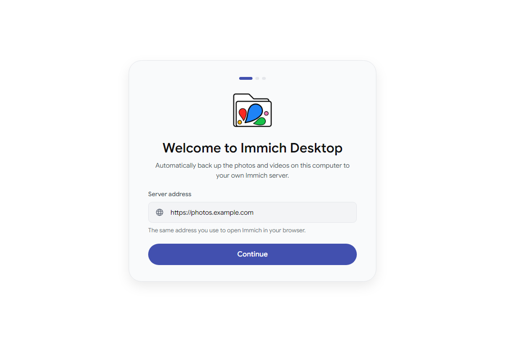
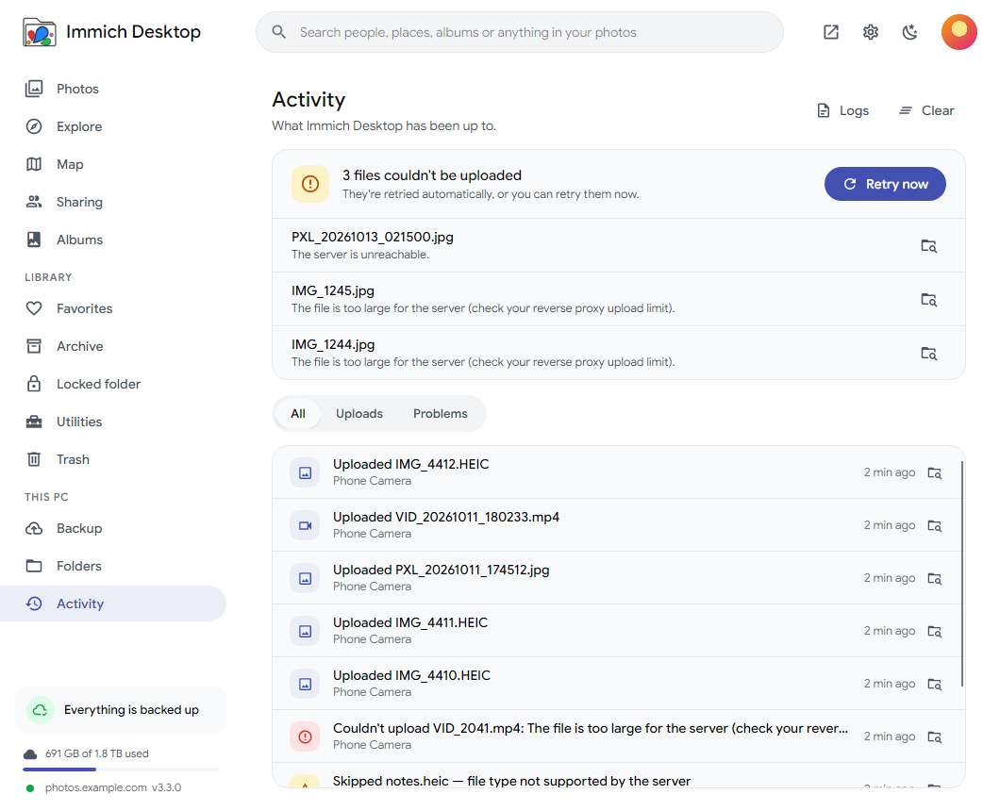

<p align="center">
  
</p>

<h1 align="center">Immich Desktop</h1>

<p align="center">
  Automatic photo &amp; video backup from your Windows PC to your own <a href="https://immich.app">Immich</a> server.<br/>
  Lives in the system tray. Built for Windows first, ready for Linux.
</p>

<p align="center">
  
</p>

## Features

- **Set up in under a minute.** Enter your server address, sign in (email/password or API key for SSO users), tick the folders to back up. Done.
- **Pick exactly what syncs.** Choose folders, photos and/or videos, include or skip subfolders, and skip files with simple patterns (`Screenshots`, `*.png`, `Trips/2019/**`).
- **Albums.** Optionally add everything from a folder to an Immich album (created automatically).
- **Lives in the tray, like Google Drive.** The tray icon shows the current state: backed up, syncing (animated), paused, offline, or needs attention. Right-click to pause (1 hour / 8 hours / until tomorrow / indefinitely), resume, sync now, open Immich, or quit. Click to open the app.
- **Never uploads twice.** Files are hashed (SHA-1) and checked against your library before upload, exactly like the mobile app. Reinstalling or re-checking never re-uploads.
- **Gentle in the background.** About 30 MB of memory when only the tray is running, below-normal CPU priority, an optional upload speed limit, and an optional pause when on battery. Cloud-only OneDrive placeholders are skipped so nothing gets force-downloaded.
- **Instant and reliable.** New files are noticed immediately (file system watcher) and a periodic full check catches anything missed. Files still being copied are left alone until they settle. Failures retry with backoff, and going offline is handled quietly.
- **Backup, not mirror.** Deleting a file on your PC never deletes anything from Immich.
- **Light and dark themes**, follows your system.
- **Clean install and uninstall.** One-click installer, Start menu + desktop shortcuts, listed in *Apps & features*, auto-updates (optional), and the uninstaller removes the autostart entry and the stored sign-in.

| | |
|---|---|
|  |  |
|  |  |

## Install (end users)

1. Open the repository's **[Releases](../../releases/latest)** page.
2. Download **`ImmichDesktop-win-Setup.exe`** and run it. That's it: no admin rights, no .NET install. It installs per-user, adds Start menu and desktop shortcuts, and opens the setup screen.
   - Prefer no install? Download **`ImmichDesktop-win-Portable.zip`**, unzip anywhere and run `ImmichDesktop.exe`.
3. Uninstall any time from **Settings → Apps → Installed apps → Immich Desktop**.

> Until the installer is code-signed, Windows SmartScreen shows "Windows protected your PC". Click **More info → Run anyway**.

## Releasing a new version

Releases are built automatically by GitHub Actions (`.github/workflows/release.yml`):

```bash
git tag v1.0.1
git push origin v1.0.1
```

A few minutes later the new `Setup.exe` appears on the Releases page. You can also start it from the **Actions** tab → *Release* → *Run workflow*.

## Build from source

Requires the [.NET 10 SDK](https://dotnet.microsoft.com/download).

```bash
dotnet run --project src/ImmichDesktop.App          # run the app
dotnet test                                         # run the tests
./build/publish.ps1 -Version 1.0.0                  # build the Windows installer (artifacts/releases/win-x64)
./build/publish.sh 1.0.0                            # build the Linux AppImage (run on Linux)
```

Developer tools (render the real UI headlessly):

```bash
dotnet run --project tools/ImmichDesktop.DevTools -- icons src/ImmichDesktop.App/Assets   # regenerate app + tray icons
dotnet run --project tools/ImmichDesktop.DevTools -- screens docs/screenshots             # screenshots, light + dark
```

Set `IMMICH_DESKTOP_DATA_DIR` to use a throwaway profile while developing.

## Project layout

```
src/ImmichDesktop.Core      Platform-neutral engine (no UI)
  Api/                      Immich REST client: discovery, login, bulk-upload-check, streaming upload, albums
  Sync/SyncEngine.cs        Scan → hash → dedupe → upload → albums, watchers, retry/backoff, status snapshots
  Storage/StateDatabase.cs  SQLite index of every file and its backup state (WAL, safe across threads)
  Settings/                 JSON settings, folder overlap rules
  Platform/                 Credentials (DPAPI / 0600 file), autostart (Run key / XDG), power, shell
src/ImmichDesktop.App       Avalonia UI: tray, onboarding, overview, folders, activity, settings
tests/                      xUnit tests, including end-to-end sync against an in-memory fake Immich server
tools/ImmichDesktop.DevTools Icon generator + headless screenshot renderer
build/                      Release + installer scripts (Velopack)
```

User data lives in `%LocalAppData%\Immich Desktop` on Windows and `~/.local/share/immich-desktop` on Linux: `settings.json`, `state.db`, `credentials.bin`, `logs/`.

## Porting to Linux

The code is already cross-platform (`net10.0`, Avalonia, no Windows-only APIs outside guarded `Platform/` code):

| Concern | Windows | Linux |
|---|---|---|
| Tray | Win32 notification icon | StatusNotifierItem over D-Bus (GNOME needs the AppIndicator extension) |
| Autostart | `HKCU\...\Run` | `~/.config/autostart/immich-desktop.desktop` |
| Credentials | DPAPI | `0600` file (swap in libsecret for keyring storage) |
| Battery | `GetSystemPowerStatus` | `/sys/class/power_supply` |
| Installer / updates | Velopack `Setup.exe` | Velopack AppImage (`build/publish.sh`) |

To-do for a polished Linux release: test on GNOME/KDE, add libsecret, and publish `.deb`/Flatpak if wanted.

## Before you publish a release

1. **Code signing.** Unsigned installers trigger a SmartScreen warning. Get a certificate (or Azure Trusted Signing) and pass `--signParams` / `--azureTrustedSignFile` to `vpk pack`.
2. **Auto-updates.** The release workflow already publishes everything the updater needs. Set `AppInfo.UpdateRepositoryUrl` (in `src/ImmichDesktop.Core/AppInfo.cs`) to the repo URL to turn on in-app updates. This only works once the repository is public; installed apps can't read releases from a private repo.
3. **Name & branding.** This is an unofficial client. Check [Immich's brand guidelines](https://immich.app) before using "Immich" in a public product name. `AppInfo.Name` is the single place to rename it.
