<p align="center">
  
</p>

<h1 align="center">Immich Splash</h1>

<p align="center">
  Automatic photo &amp; video backup from your PC to your own <a href="https://immich.app">Immich</a> server, and your whole library on the desktop.<br/>
  Lives in the system tray. Looks and feels like Immich. For Windows and Linux.
</p>

<p align="center">
  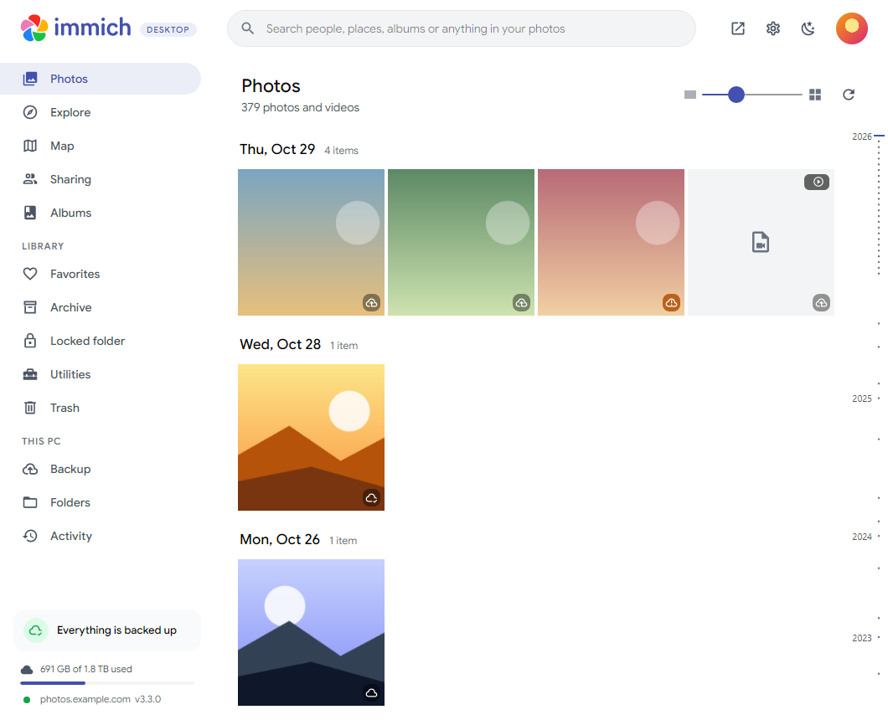
</p>

## Features

- **Feels at home next to Immich.** Google Sans, Immich's colors and a familiar layout (top bar, sidebar, storage meter and server status), with its own logo so it's never mistaken for an official app.
- **Light, dark or follow Windows.** One click on the sun/moon in the top bar, or choose in Settings.
- **Your library, like the web and mobile apps.** A sidebar with Photos (with a date rail to jump through the years), Explore (people and places), Map, Sharing (shared albums, your links, partners) and Albums, plus a Library group: Favorites, Archive, Locked Folder (unlocked with your PIN) and Trash. Search from the top bar, with suggestions and recent searches. Photos keep their shape in the grid, and right-click menus are everywhere. Drop files on the window (or on an open album) to upload them.
- **A full viewer.** Zoom, favorite, copy, download, add to album, slideshow, archive, move to the locked folder, view similar photos, and a detailed info panel. Videos play right in the app with volume, a draggable progress bar and previews as you point along it.
- **Edit photos.** Turn, flip and crop (free or with a fixed shape) using Immich's own editing, applied to the full-quality original on your server; take the edits off again any time.
- **Albums.** Filter (all, yours, shared with you), search, six ways to sort, group by year, cover or list view. Create and edit albums, and the three you used last are one click away in the sidebar. "Add to album" searches your albums or creates a new one from the same box.
- **People.** Name the faces Immich found, merge someone found twice into one person, or discard a face.
- **Offline map.** A built-in world map with country and state lines, photo thumbnails, a heat map and a side panel with the photos of the area you're looking at; online street detail is optional.
- **Utilities.** Review duplicates, archive screenshots and screen recordings, find your largest files, and see which files on this PC aren't in Immich yet.
- **Private photos, found on your PC.** An optional check suggests photos for the locked folder (nudity, payment cards, IDs, bank and tax papers, passwords, medical records). It runs entirely on your PC with on-device models (NudeNet for nudity, plus an optional thorough mode with CLIP that also understands drawings, art and game screenshots); your photos and results are never sent anywhere and nothing is moved without you.
- **Share.** Select photos (or a whole album) and create a share link with an expiry date, copied straight to your clipboard. Share albums with people on your server as viewers or editors, and manage your links (copy, allow downloads, delete). Shared photos are marked in the grid and the viewer.
- **Locked folder.** Open it with your PIN, or create a PIN right in the app; change or remove it in Settings.
- **Desktop picture frame.** Your desktop background can rotate through photos from your favorites, an album or the whole library.
- **Your profile picture.** Shown from Immich. Change it in Settings by picking a photo from your Immich library (or your PC), then move, zoom and rotate it in the circle, just like the web app.
- **Every way to sign in.** Email & password, **SSO / OAuth** (Authentik, Keycloak, Google, …) through your browser, or an API key.
- **App lock.** Require **Windows Hello** (face, fingerprint, PIN) or an app password to open the window. Backup keeps running while it's locked; it re-locks when the window closes or after 5 minutes idle.
- **Choose exactly what syncs.** Per folder: photos and/or videos, subfolders, skip patterns (`Screenshots`, `*.png`, `Trips/2019/**`), and an optional album.
- **Lives in the tray, like Google Drive.** The tray icon shows backed up / syncing (animated) / paused / offline / needs attention. Right-click to pause (1 h, 8 h, until tomorrow, indefinitely), resume, sync now, open Immich, or quit.
- **Never uploads twice.** Files are hashed and checked against your library first, exactly like the mobile app.
- **Home and away.** Automatic server switching like the mobile app: a local address on your home network, any number of external addresses elsewhere. Data saving on metered connections (photos only, or pause).
- **Your language.** English, Deutsch, Español, Français and Português; dates and numbers follow.
- **Light on your PC.** About 30 MB of memory in the tray, low CPU priority, optional speed limit and pause on battery. Skips cloud-only OneDrive files. Graphics acceleration can be turned off if your graphics driver misbehaves.
- **Proper installer and updates.** A setup wizard where you choose the install location and whether it's for you or for everyone; a clean uninstaller; automatic updates from GitHub Releases (optional).

| | |
|---|---|
| 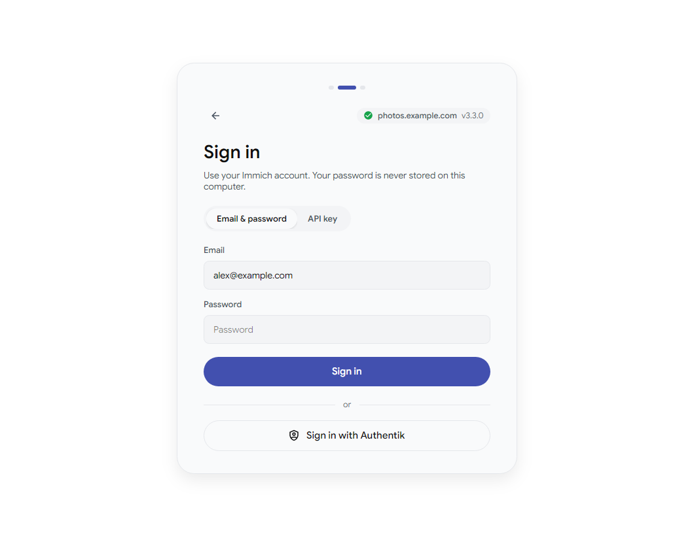 | 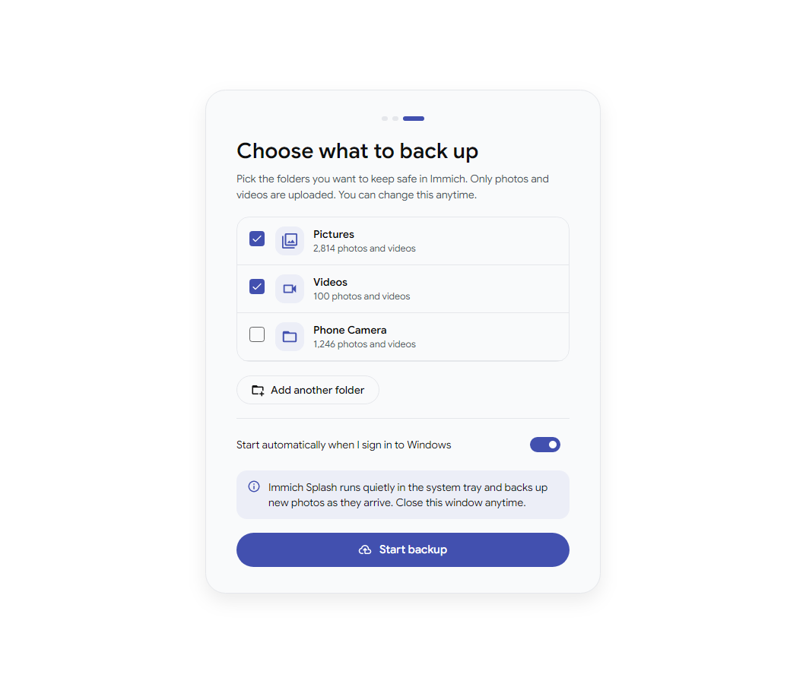 |
| 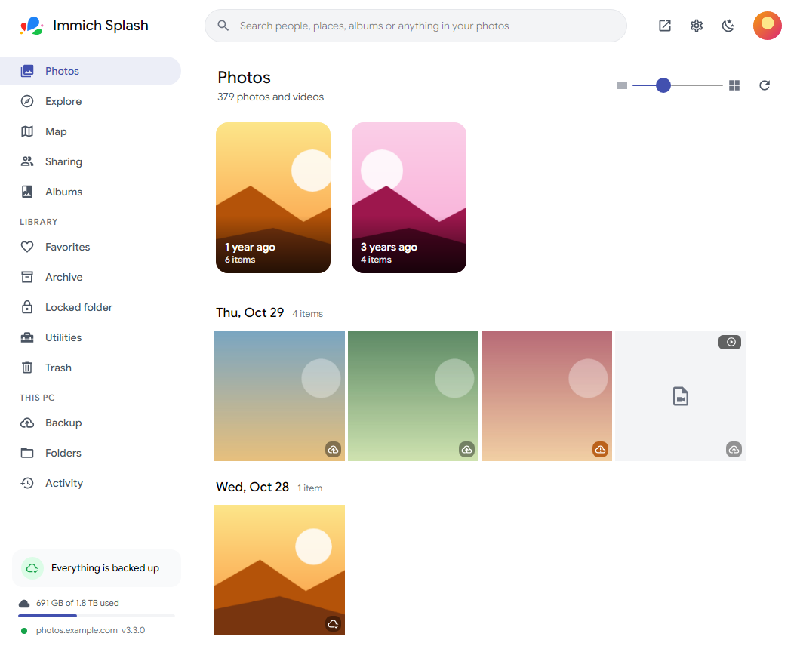 | 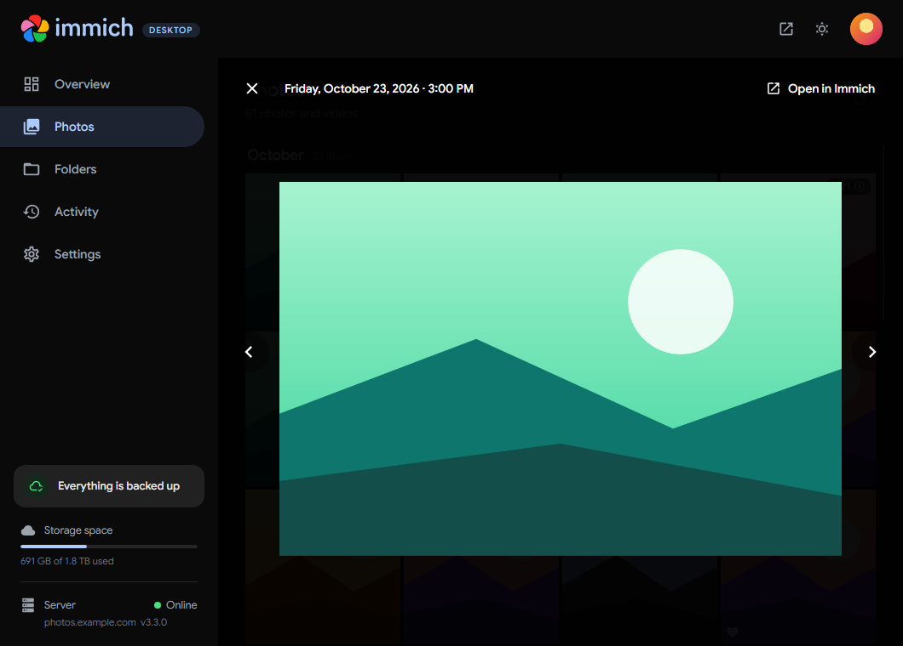 |
| 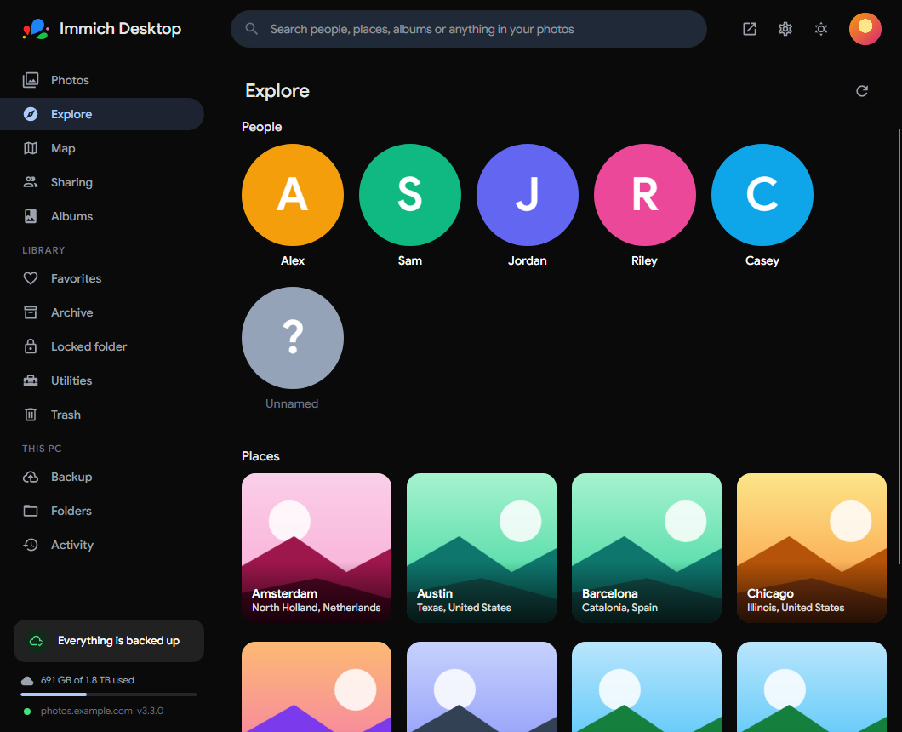 | 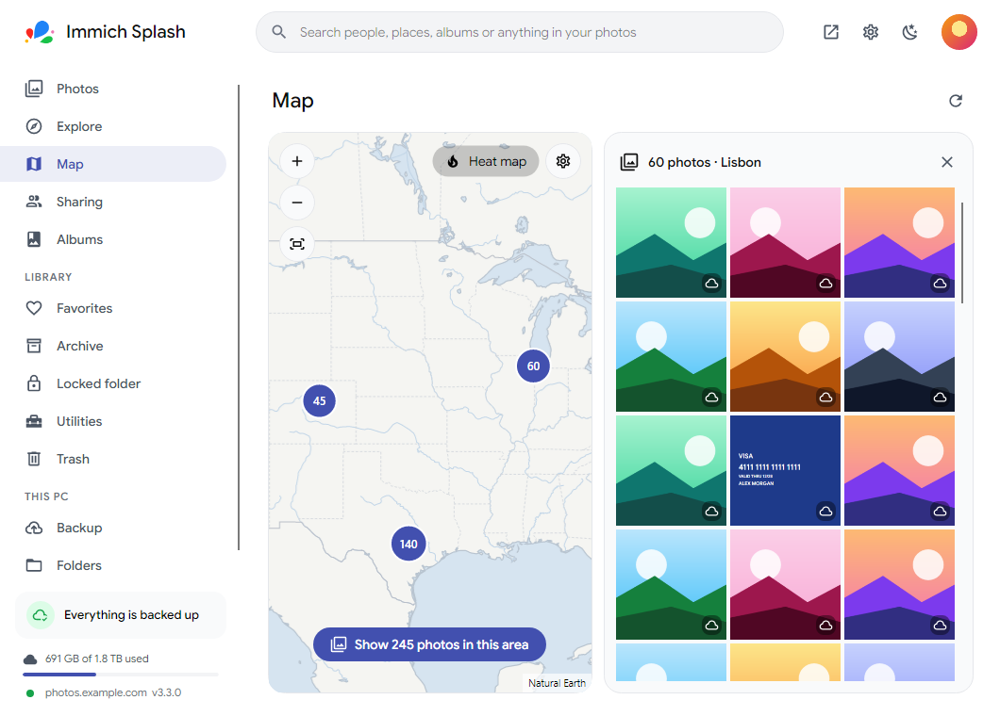 |
| 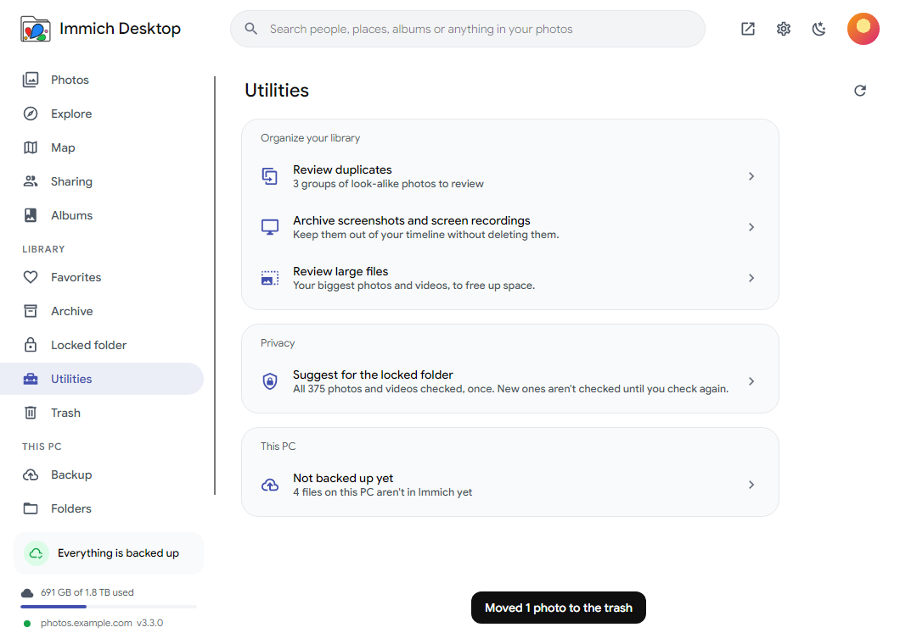 | 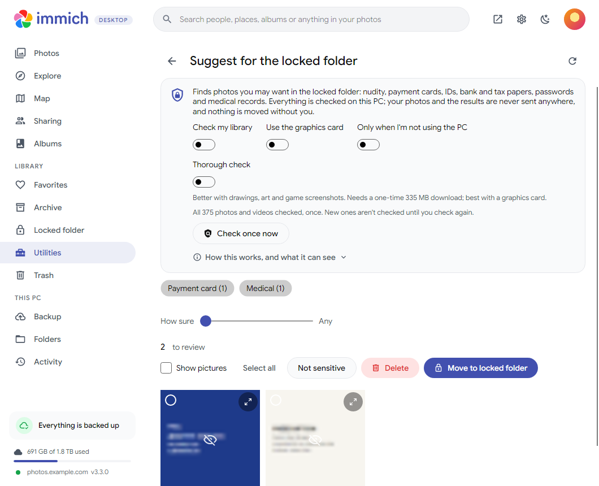 |
| 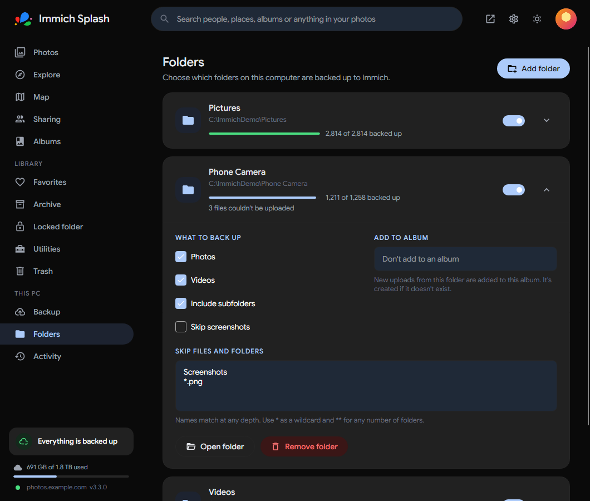 | 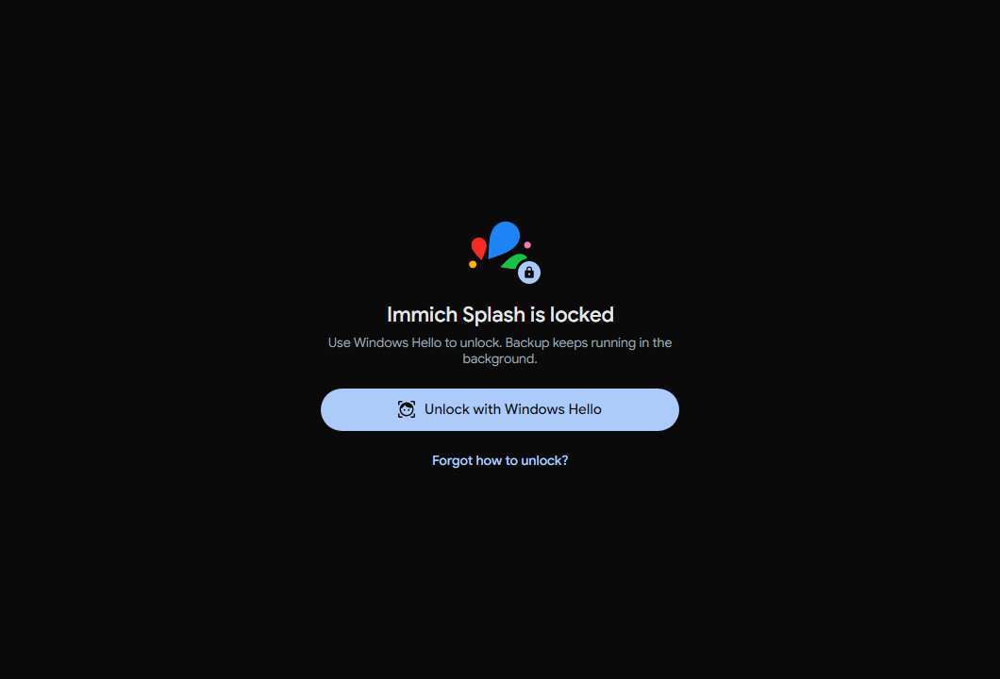 |

## Install

1. Go to **[Releases](../../releases/latest)** and download **`ImmichSplash-Setup.exe`**.
2. Run it and follow the wizard: choose *just me* (no admin) or *everyone*, pick the install folder, optional desktop shortcut.
3. Sign in to your Immich server and pick folders. Done. The app keeps running in the tray.

No-install option: **`ImmichSplash-Portable.zip`**: unzip anywhere and run `ImmichSplash.exe` (no auto-updates).

Uninstall from **Settings → Apps → Installed apps → Immich Splash**. You'll be asked whether to keep your settings; nothing is ever removed from your Immich server.

**Linux:** download **`ImmichSplash-linux-x64.tar.gz`**, extract it and run `./install.sh`. It installs to `~/.local/opt/immich-splash` and adds a menu entry; `./install.sh --uninstall` removes it. For videos to play in the app, install mpv's library (`sudo dnf install mpv-libs`, `sudo apt install libmpv2`, …). Linux installs don't update themselves yet: download the new tarball and run `./install.sh` again.

**Linux (Flatpak), with updates:** add the app's own Flatpak repository in one step (it pulls the runtime from Flathub):

```sh
flatpak install --user https://typicalzedf.github.io/immich-splash/io.github.TypicalZedF.ImmichSplash.flatpakref
```

Then start it from your app menu or with `flatpak run io.github.TypicalZedF.ImmichSplash`; `flatpak update` gets new versions. No repository wanted? Each release also has **`ImmichSplash.flatpak`**: `flatpak install --user ImmichSplash.flatpak` (no updates that way).

> Until the installer is code-signed, Windows SmartScreen shows "Windows protected your PC". Click **More info → Run anyway**.

## Security & privacy

| What | Where | How it's protected |
|---|---|---|
| Your Immich password | **Never stored** | Sent once to your server to sign in. |
| Session token / API key | `credentials.bin` | Encrypted with Windows DPAPI: only your Windows account can read it. |
| App lock password | `settings.json` | Only a salted PBKDF2-SHA256 hash (600k iterations). |
| Email, name, server address | `settings.json` | Plain text (shown in the app; not secret). |

The app lock protects against someone using your unlocked PC; it can't stop someone who already controls your Windows account.

SSO uses the standard OAuth authorization-code flow with PKCE. Your identity provider sends the browser back to `app.immich:///oauth-callback`, the same redirect the official mobile app uses, so it works wherever mobile SSO works.

## Updates

Installed copies check this repository's **latest GitHub Release** every few hours (Settings → Updates). New installers are downloaded in the background, verified against GitHub's SHA-256 digest, and installed:

- **automatically** while the window is closed and nothing is uploading (if enabled), or
- when you click **Restart to update**.

**Beta channel.** Settings → Updates → Update channel → **Beta** also installs pre-releases, so you get new features first. Switching back to **Stable** never downgrades; you move over with the next stable version.

## Releasing a new version

Everything ships from one button: **Actions → Ship → Run workflow**, then pick **Beta** or **Stable**.

| Choice | What you get |
|---|---|
| **Beta** | A pre-release such as `1.6.4-beta.12`. Only installs on the Beta update channel get it. |
| **Stable** | A release for everyone, such as `1.6.3`: Windows installs update themselves, Flatpak installs through Discover or `flatpak update`. Optionally type a version (e.g. `1.7.0`); empty means the next one. |

It ships the newest tested work (the `beta` branch, or `main` when there's no beta) through numbered steps, and each step writes a short report on the run's page:

1. **Prepare**: picks the code and version; brings in anything new on `main`.
2. **Test**: builds and runs every test. Nothing is published if they fail.
3. **Windows app** and **Linux app**: the installer and portable zip (really installed, started, quit and uninstalled on a clean machine), and the Linux tarball.
4. **Flatpak**: the Flatpak (signed for Stable).
5. **Publish**: the GitHub release with every download. Stable also moves `main` to this code.
6. **Flatpak repository** (Stable): updates the repository Flatpak installs update from.
7. **Tidy up**: removes older betas. Stable also removes the `beta` branch once everything on it is released.

If a step fails, fix it and press the button again: it carries on with the same version. Pushes to branches never publish anything; CI just checks them (tests, a real install on Windows, and every screen rendered against a demo server). From a terminal, `./build/ship.ps1 [-Channel Stable]` presses the same button and follows the run.

## Build from source

Requires the [.NET 10 SDK](https://dotnet.microsoft.com/download). For the installer: `winget install JRSoftware.InnoSetup`.

```bash
dotnet run --project src/ImmichSplash.App        # run the app
dotnet test                                       # run the tests
./build/publish.ps1 -Version 1.2.0                # installer + portable zip -> artifacts/installer
./build/publish.sh 1.2.0                          # Linux tarball (run on Linux)
```

Developer tools (render the real UI headlessly):

```bash
dotnet run --project tools/ImmichSplash.DevTools -- icons src/ImmichSplash.App/Assets   # app + tray icons
dotnet run --project tools/ImmichSplash.DevTools -- installer build/installer            # installer wizard art
dotnet run --project tools/ImmichSplash.DevTools -- screens docs/screenshots             # screenshots
```

Set `IMMICH_SPLASH_DATA_DIR` to use a throwaway profile while developing.

## Project layout

```
src/ImmichSplash.Core       Platform-neutral engine (no UI)
  Api/                       Immich REST client: discovery, login, OAuth/PKCE, uploads, library, albums, search, sharing
  Sync/SyncEngine*.cs        Scan → hash → dedupe → upload → albums, watchers, retry/backoff (one file per stage)
  Storage/StateDatabase.cs   SQLite index of every file and its backup state
  Privacy/                   On-device checks for the locked-folder suggestions (ONNX models, OCR)
  Updates/                   GitHub Releases update checker (SHA-256 verified downloads)
  Platform/                  Credentials (DPAPI), autostart, app.immich:// link handler, password hashing, power, network
src/ImmichSplash.App        Avalonia UI: tray, onboarding, lock screen, library (Views/Photos*), map, backup, settings
  Assets/i18n/               Translations (English text is the key; tests keep the files in step)
tests/                       xUnit tests incl. end-to-end sync against a fake Immich server
tools/ImmichSplash.DevTools Icons, installer art and screenshots rendered from the real UI
build/                       publish.ps1 / installer.iss (Inno Setup) / publish.sh (Linux)
```

## Linux

The code is cross-platform: Windows-only pieces (DPAPI, registry, Windows Hello) are isolated and have Linux fallbacks: XDG autostart, a `0600` credentials file, `/sys/class/power_supply`, an `x-scheme-handler` for SSO and an app password instead of Windows Hello. Every release includes a Linux tarball (see [Install](#install)), built by `build/publish.sh`. CI builds and tests on Linux on every push.

## Credits

Immich is © FUTO / the Immich contributors; the name is used here only to say what this app works with. The app's logo is its own. This is an unofficial, community-made companion app and is not affiliated with or endorsed by the Immich project or FUTO. Google Sans is licensed under the SIL Open Font License (`src/ImmichSplash.App/Assets/Fonts/OFL.txt`).
